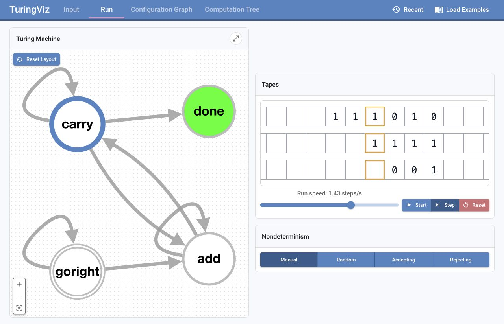
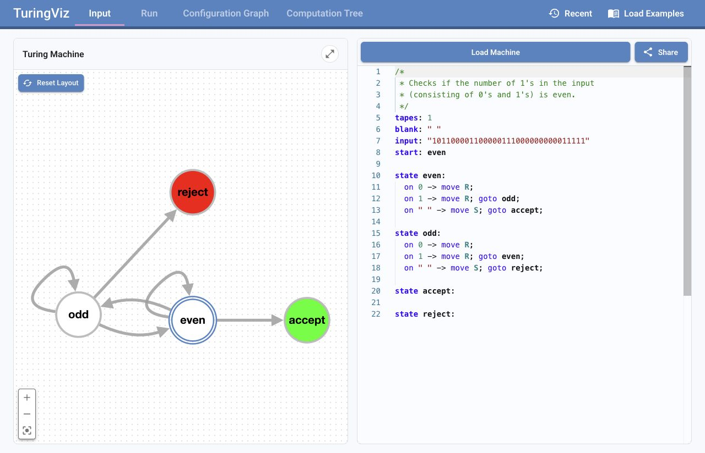
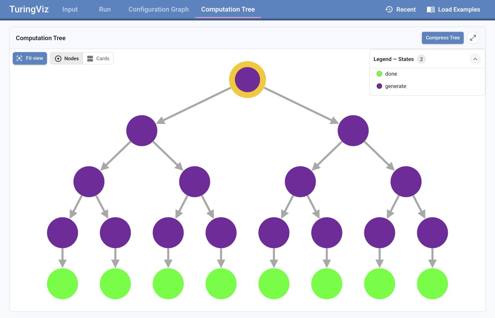

# TuringViz

**Explore Turing machines, one configuration at a time.**

TuringViz is an interactive visualizer for deterministic and nondeterministic
**k-tape Turing machines**. Write a machine, follow its execution across multiple
tapes, and explore its state graph, configuration graph, and computation tree.
Built for learning, teaching, and experimenting with models of computation.

**[Open TuringViz](https://turingviz.org)** ·
[Language reference](src/tmLanguage/turingviz-machine-language.md) ·
[Architecture](docs/architecture.md) ·
[Report an issue](https://github.com/TuringViz-org/TuringViz/issues)



_BinaryAdd in the Run view: follow the active state, tape contents, and head positions
as the machine adds two binary numbers._

## Features

- **Multiple perspectives:** inspect the machine's state graph, explore reachable
  configurations, and unfold alternative runs in a computation tree.
- **Interactive execution:** step through transitions or run automatically at an
  adjustable speed, with support for machines using **1–6 tapes**.
- **Nondeterministic branching:** choose transitions manually or use Random,
  Accepting, and Rejecting run modes.
- **A dedicated machine language:** write compact transition rules in a Monaco
  editor with syntax highlighting, inline diagnostics, and hover documentation.
- **Examples and sharing:** start from built-in machines, revisit recent machines,
  share programs through a link, or import them from GitHub Gists.

## Get started

1. Open **[turingviz.org](https://turingviz.org)** and select **Load Examples**.
   Start with **CheckEven** for a small machine or **BinaryAdd** for multiple tapes.
2. Open **Run**. Use **Step** to follow individual transitions or **Start** to run
   the machine automatically. **Reset** returns to the initial configuration.
3. Open **Configuration Graph** or **Computation Tree** to explore the machine's
   behavior beyond a single run. For a branching example, try **AllStrings**.

## Write your own machine

Define the tapes, blank symbol, input, and initial state, then add transition rules.
This machine accepts binary strings containing an even number of `1` symbols:

```text
tapes: 1
blank: _
input: "1010"
start: even

state even:
  on 0 -> move R;
  on 1 -> move R; goto odd;
  on _ -> move S; goto accept;

state odd:
  on 0 -> move R;
  on 1 -> move R; goto even;
  on _ -> move S; goto reject;

state accept:
state reject:
```

Paste it into the **Input** editor, click **Load Machine**, and switch to **Run**.
The language also supports multi-tape read patterns, optional `write` and `goto`
actions, `same` to preserve a symbol, `choose { ... }` blocks for nondeterminism,
and readable `if ... then ...` rules. See the
[language reference](src/tmLanguage/turingviz-machine-language.md) for syntax and
examples.



_The Input view pairs the machine definition with its state graph. Shown here:
the built-in CheckEven example._

## Explore branching computations

The **configuration graph** connects reachable configurations, including their
tape contents and head positions. The **computation tree** unfolds possible runs:
the same configuration can appear on different branches if reached by different
paths.

Both views offer compact nodes and detailed configuration cards. Tree compression
merges linear paths into single edges. Larger explorations use a configurable
target node count, so a displayed graph or tree may represent only part of the
computation.



_AllStrings with input `000`: nondeterministic choices generate every binary string
of length three, producing eight completed runs._

## Share and load machines

- **Share links:** click **Share** in the editor to create a link containing the
  current program in the URL hash (`#tm=...`).
- **GitHub Gists:** open `https://turingviz.org/?gist=<gist-id>` to import a program.
  Add `&file=machine.tvm` to select a specific file in a Gist.
- **Recent machines:** use **Recent** to revisit previously loaded programs.

## Built-in examples

The **Load Examples** menu includes machines ranging from simple recognizers to
nondeterministic search problems.

<details>
<summary>Browse all 13 examples</summary>

| Example           | What it demonstrates                                                         |
| ----------------- | ---------------------------------------------------------------------------- |
| `BinaryAdd`       | Adds binary numbers from tapes 1 and 2, writing the result on tape 3.        |
| `NonDetSubstring` | Guesses a start position and checks whether tape 2 is a substring of tape 1. |
| `vvWord`          | Checks whether the input is the same substring repeated twice.               |
| `NonDetSubSetSum` | Solves subset sum nondeterministically using binary-encoded numbers.         |
| `CheckEven`       | Accepts binary inputs containing an even number of `1` symbols.              |
| `0^n1^n`         | Checks for equally many zeros followed by ones.                              |
| `GCD`             | Computes the greatest common divisor of two unary numbers.                   |
| `AllStrings`      | Generates all binary strings of a fixed input length.                        |
| `Fib`             | Has exactly `fib(n)` accepting paths on input `1^n`.                         |
| `DAG`             | Produces an acyclic configuration graph.                                     |
| `Circle`          | Produces a cyclic configuration graph.                                       |
| `NonDetSAT`       | Solves SAT nondeterministically for formulas in conjunctive normal form.     |
| `UniversalTM`    | Simulates an encoded single-tape machine on four tapes; defaults to `0^n1^n`. |

</details>

To add an example, save its source as a `.tvm` file in `src/examples/` and add
one registration in `src/utils/ExampleTMs.ts`:

```ts
export const MyMachine = registerExample('My machine', 'MyMachine.tvm');
```

The first argument is the menu label; the second is the filename relative to
`src/examples/` (subfolders are supported). Registration order determines menu
order. The source files are bundled automatically; no separate import or menu
change is needed. Edit an existing `.tvm` file to update that example.

## Local development

Install **Node.js (LTS)** and **npm**, then run:

```bash
git clone https://github.com/TuringViz-org/TuringViz.git
cd TuringViz
npm ci
npm run dev
```

Open the local URL printed by Vite.

| Command                 | Purpose                                       |
| ----------------------- | --------------------------------------------- |
| `npm run dev`           | Start the development server.                 |
| `npm run build`         | Create the production bundle in `dist/`.      |
| `npm run preview`       | Preview the production bundle after building. |
| `npm run typecheck`     | Check application and test types.             |
| `npm test`              | Run tests in watch mode.                      |
| `npm test -- --run`     | Run the test suite once.                      |
| `npm run test:coverage` | Run tests with coverage reporting.            |

The application uses **React, TypeScript, and Vite**, with Material UI, Monaco
Editor, Cytoscape, React Flow, OpenEdges ELK (Rust/WebAssembly), and Zustand.
The [local WASM build](src/vendor/elk-wasm/README.md) includes stack-safe graph
traversals for Safari workers. Optional developer algorithms select a lazily
loaded ELK.js compatibility backend to preserve their existing layouts.
Tests use Vitest and Testing Library. The [architecture guide](docs/architecture.md)
covers graph computation, layout, loading, and fullscreen lifecycles.

Write documentation, code comments, and user-facing text in **English**.

## Contributing and feedback

Bug reports, improvements, and new example machines are welcome. Open a
[GitHub issue](https://github.com/TuringViz-org/TuringViz/issues) or email
[public@christoph-greger.de](mailto:public@christoph-greger.de).

If you submit an example machine, include its purpose, a sample input, and the
expected behavior. Included examples receive author credit. We would also like
to hear how you use TuringViz in courses, lectures, or projects.

## Project background

TuringViz began in the **Software Engineering Lab** course at the **University of
Regensburg**, developed by **Christoph Greger** and **Gregor Porsch**. Beyond the
core functionality and initial prototypes, LLM agents also supported a significant
part of the development process.

We thank the **Chair of Algorithms and Complexity** for its continued support
throughout the development of TuringViz.

## License and acknowledgements

TuringViz is released under the [BSD 3-Clause License](LICENSE).
The vendored OpenEdges ELK backend includes its own
[license](src/vendor/elk-wasm/LICENSE) and [attribution](src/vendor/elk-wasm/NOTICE).

The project's input format draws inspiration from the YAML-based Turing machine
description format used by [turingmachine.io](https://turingmachine.io/)
([aepsilon/turing-machine-viz](https://github.com/aepsilon/turing-machine-viz)),
which is licensed under the BSD 3-Clause License. The current TuringViz editor uses
its own machine language. TuringViz does not include source code from
turingmachine.io.
