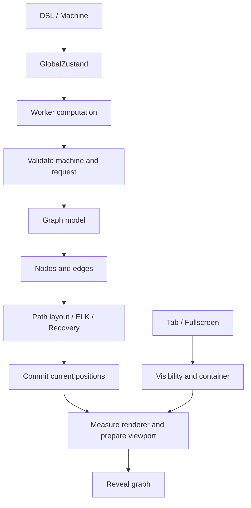

# Architecture and Graph Lifecycle

TuringViz separates the machine model, graph computation, layout, and rendering.
This separation allows graph computation to continue across tab switches while
keeping the graph hidden until its positions and viewport are ready.

## Responsibilities

| Area                 | Entry point                                                                                                               | Responsibility                                                            |
| -------------------- | ------------------------------------------------------------------------------------------------------------------------- | ------------------------------------------------------------------------- |
| Language             | `src/tmLanguage/`                                                                                                         | Lexer, parser, validation, and machine import                             |
| Machine state        | `src/zustands/GlobalZustand.ts`                                                                                           | Machine, execution state, configuration graph, and versions               |
| Presentation options | `src/zustands/GraphZustand.ts`                                                                                            | Node mode, layout options, and computation budgets                        |
| Pure computation     | `src/tmfunctions/configGraphModel.ts`, `ComputationTree.ts`                                                               | Reachable configurations and the unfolded tree                            |
| Worker transport     | `src/utils/graphWorkerClient.ts`                                                                                          | Separate graph and tree channels, cancellation, and error handling        |
| Worker protocol      | `src/workers/graphComputeProtocol.ts`                                                                                     | Shared message types and identical worker/fallback computation            |
| Result publication   | `src/services/configGraphComputation.ts`                                                                                  | Atomically commit results for the current machine only                    |
| Tree data            | `src/components/ComputationTree/useComputationTreeData.ts`                                                                | Model computation independent of the renderer and active UI tab           |
| Geometry             | `src/components/shared/layout/`                                                                                           | ELK inputs, path layout, recovery, direction, and scaling                 |
| Layout scheduling    | `useGraphElkLayout.ts`                                                                                                    | Worker ownership, current requests, versioning, and successful completion |
| Presentation         | `TMGraph.tsx`, `ConfigGraphCards.tsx`, `ConfigGraphCircles.tsx`, `ComputationTreeCards.tsx`, `ComputationTreeCircles.tsx` | Renderers, viewport, interaction, and loading indicators                  |
| Tabs/fullscreen      | `App.tsx`, `MainPage/PortalBridge.tsx`, `FullscreenShell.tsx`                                                             | Graph view lifetime and DOM destination                                   |

The small `ConfigGraph.tsx` and `ComputationTree.tsx` facades select the renderer.
Cytoscape draws the state graph and circular nodes; React Flow draws configuration
cards. Each renderer retains its own pan/zoom, measurement, and fitting rules.
Renderer components compose focused modules:

- `ConfigGraph/hooks/` separates circle data reconciliation from viewport and
  loading state. `TMGraph/hooks/` separates data, interactions, and viewport.
- `ComputationTree/useTreePresentation.ts`, `useTreeCircleLayout.ts`, and
  `useTreeCircleViewport.ts` separate presentation data, layout, and viewport.
- Each renderer's `rendering/elements.ts` builds Cytoscape elements without UI
  effects. Shared `cytoscapeElements.ts` reconciles them in builder order while
  retaining existing instances. Styles and controls remain separate.

Cytoscape initialization, element reconciliation, selection classes, and container
observation run in that order. Hook extraction must preserve this ordering: an
observer or selection update must not depend on an incidental later render.



## Computation and Result Publication

Each graph type has its own worker channel. A new request replaces any computation
still running for the same type. Worker identity and request ID guard against
stale responses; workers can be reused after completing a request. Switching tabs
does not cancel computation.

Worker startup, transport, and deserialization failures, as well as the existing
4.5-second timeout, fall back to the same pure computation on the main thread.
The node budget and computation order remain unchanged. Computation errors
reported by a worker reject the promise. The synchronous fallback can still
occupy the main thread for large graphs.

`configGraphComputation.ts` is the shared entry point for loading a machine and
manually recomputing its graph. Before committing, it checks the request number,
`machineLoadVersion`, and relevant machine inputs. The graph and
`configGraphVersion` are published in one state update.

`beginConfigGraphCompute()` returns an idempotent completion callback tied to the
current machine generation. A delayed `finally` from an old computation cannot
change the loading counter of a new machine.

The BFS implementation in `configGraphModel.ts` has no store or UI dependencies.
A queue with a read index avoids repeatedly shifting the whole array while
preserving the order of nodes, transitions, and pending configurations.

## Layout

Normal layout runs through a local WebAssembly build of OpenEdges ELK 0.12.0.
The Rust source is pinned to the upstream release and patched to avoid recursive
graph traversals that overflow Safari's worker stack. The generated backend,
source patch, license, and rebuild instructions live in `src/vendor/elk-wasm/`;
`@openedges/elk-layout` supplies the compatible TypeScript graph types.
`elkWorkerClient.ts` creates workers lazily: a module
worker (`elkLayout.worker.ts`) for WASM, or the original ELK.js worker for legacy
developer algorithms. Each selected worker is reused until the hook disposes it.
Request IDs associate responses with their promises. Termination and transport
failures reject pending requests immediately. The existing 12-second deadline,
unmount cancellation, and recovery layout still apply. In environments without
Web Workers, `elkBackend.ts` selects and lazily loads the corresponding backend
on the calling thread.

Vite emits the worker, local ESM loader, and `.wasm` asset into the production
build. The same relative binary URL works in development. Worker output uses
ES modules. No external CDN or runtime Rust installation is needed. Separate
lazy chunks keep the legacy JavaScript backend out of normal WASM layouts,
including the no-worker fallback. A WASM failure does not switch to JavaScript.

Before posting a normal layout, `compactElkGraph.ts` replaces long configuration
IDs with short transport IDs, preserving input order and options. It restores
all node, edge, and section references when the worker returns. This avoids
serializing large configuration strings repeatedly inside WASM and across
workers. Unsupported graph structures use their original IDs unchanged.

The layout hook requests positions-only output. Rust still performs the complete
layout with the same options, then exports just root and node geometry for the
supported flat graphs. This avoids building, serializing, and transferring edge
sections that TuringViz never reads. The importer retains the original child order
and uses the same numeric conversion as the full exporter. Richer graphs use the
full exporter, and callers that do not opt in still receive the complete ELK
result. Developer algorithms retain their original ELK.js output.

`graphLayout.ts` contains pure functions for ELK inputs, topology keys, node sizes,
and recovery layouts. `singlePathLayout.ts`, `autoDirection.ts`, and
`scaleToContainer.ts` retain the existing geometry rules. Successful layouts
continue to use the same options, ordering, and spacing.

The normal UI uses the `layered` algorithm. `ElkWasmLayout.test.ts` executes the
actual browser WASM against 28 frozen ELK.js 0.10.0 layouts, including all bundled
example state graphs, cycles, disconnected components, circle/card dimensions,
and all four directions. Coordinate comparisons allow only `1e-6` floating-point
rounding differences. OpenEdges follows ELK 0.12.0, whose `force`, `mrtree`,
`stress`, and `radial` layouts can differ from ELK.js 0.10.0. These algorithms
remain selectable in the TMGraph developer controls (`?dev=true` or `/dev`) and
use the pinned ELK.js 0.10.0 compatibility backend in a dedicated worker.
The bundled ELK.js entry point must not run inside the WASM worker: it detects
the worker global and replaces its message handler.
`ElkBackend.test.ts` verifies exact positions against the six additional
legacy fixtures and checks that normal layouts initialize only WASM.
`ElkCompactGraph.test.ts` additionally checks the complete default NonDetSAT
configuration graph (14,199 nodes) against its legacy coordinate digest and
runs a 10,000-node chain in a worker with a 1 MiB stack to catch recursive
traversals that can fail in Safari.

`useGraphElkLayout` retains the latest committed inputs and processes requests
serially. It coalesces additional restart requests while a layout is running. The
next pass reads the current options. Results are committed only if the request,
topology, and hook lifetime still match. An AbortController stops waiting on
unmount and also protects React StrictMode from delayed results belonging to an
earlier mount cycle.

Each run snapshots node IDs and edge endpoints. An ordered comparison accepts an
unchanged topology without rebuilding its sorted key. Any difference falls back
to the original canonical comparison, preserving the treatment of reordering,
duplicate edges, and self-loops. Snapshot values also detect in-place mutations.

A hidden application panel may report a size of `0 × 0`. Background computation
then retains the last usable container size. A failure in a hidden browser
document is retried on `visibilitychange`; a hidden application panel still
receives its recovery layout.

**`running === false` does not mean positions are available.** Only a new
`completedLayouts` number after the current request stops running indicates
successful completion. Renderers schedule their pending fit request only then.
This also applies to synchronous path layouts, which produce their result before
the busy phase ends. Configuration circle views and the shared card viewport
retain pending fit or restore requests until the current viewport operation
actually succeeds. A container resize can start another layout and cancel a
queued viewport frame. Consuming its request when scheduling would leave the
loading indicator waiting indefinitely or lose the saved viewport restoration.

## Loading Indicators and Viewport

Rendering follows this sequence:

1. Reconcile the graph model with renderer nodes and edges, retaining existing
   measurements and valid positions.
2. Mask the graph and request a layout for each new structural revision.
3. Prepare the viewport only after a successful layout.
4. Await React Flow's `fitView` and, where needed, `setViewport`. After each
   `await`, check that the request is still current.
5. Reveal the graph only after the renderer commit and the existing settling
   interval.

Shared hooks enforce this sequence:

- `useGraphLayoutRequest`: one structural layout request per measured revision.
- `useDebouncedLayoutRestart`: coalesce requests within a frame and reschedule
  pending work when StrictMode replays effects.
- `useGraphFrameTask`: replace or cancel scheduled frames; `isCurrent()` guards
  promise continuations already in progress. Async callbacks handle their own
  errors and recheck validity after each `await`.
- `useCardViewportState`: declare structural invalidation and post-layout fit or
  restore intent before layout starts.
- `useCardGraphViewport`: share card viewport storage, awaited fit/restore,
  measurement retries, tab activation, and portal handling. Graph-specific
  topology revisions and dimension guards remain explicit in each renderer.
- `useGraphReveal`: immediately mask a blocked card view and reveal it only after
  two frames and the existing 90 ms settling interval.

Card renderers also check the actual DOM dimensions. React Flow may retain stale
width and height values in its store while a tab is hidden. A layout may complete
in the background; its visible fit is deferred until the tab becomes visible
again. Recomputing an unchanged topology retains the valid viewport.

The viewport calculated by React Flow's fit operation is the geometry reference.
Do not center the start node again after awaiting `fitView`: for large trees at
the minimum zoom, this would shift the existing presentation. Missing card
measurements keep the fit request pending until measurements are ready. Moving
the portal immediately invalidates any fit continuations already in progress.

## Tabs and Fullscreen

`App` mounts expensive panels when first opened and retains them for the loaded
machine. Switching to Run therefore does not remove the graph. The `active`
property controls visible updates and resize behavior, not model computation.
`useGraphCurrentConfiguration` suppresses unnecessary highlight updates in hidden
panels and applies the current execution state when the user returns.

`PortalBridge` owns a stable DOM element and moves it between the normal panel and
the fullscreen container. The React tree, renderer, and viewport remain intact.
The before-switch event allows immediate masking. The after-switch event is
versioned so that a stale microtask cannot trigger an action after another switch
or unmount.

`FullscreenShell` keeps its target available and displays the existing loader
during the dialog transition. `useFullscreenState` discards delayed transition
callbacks after the dialog closes. Changing tree compression does not move the
portal out of fullscreen and back in.

Hidden portal containers use `opacity: 0` in addition to `visibility: hidden`.
React Flow sets its nodes to `visibility: visible`, so inherited visibility alone
would briefly expose cards without their edges. The opacity mask retains
dimensions and mount state while hiding all descendants.

## Graph Details and Selection

`GraphUIProvider` owns typed selection, anchors, and the panel's active state.
`useCytoscapeGraphInteractions` shares circle node/edge events, hover timing,
selection priority, and detail lifetime. `useCardGraphSelection` supplies the
same click anchors and pane dismissal to both card renderers. Shared
`ConfigurationDetailPopper` and `graphAnchor.ts` handle configuration details and
anchor conversion; graph-specific pending-configuration behavior stays explicit.

Clicked details take priority over transient hover previews. Cytoscape handlers
update their selection refs immediately so another event in the same gesture or
a delayed hover callback cannot replace the selected detail. Selecting a node
closes the edge detail, and selecting an edge closes the node detail.

Edge details are pointer-transparent, including the Popper wrapper. Outside
dismissal runs on mouse/touch down, before Cytoscape selects an element on
mouse/touch up; a trailing document click must not clear that new selection.
Inactive panels hide their portalled details and cancel pending hover previews
without cancelling graph computation.

## Extending and Testing the Architecture

New graph algorithms belong in pure model or geometry modules. New renderer
actions must use the existing task scopes. Do not add unmanaged nested
`requestAnimationFrame` or timeout chains to reveal a graph. A fit that finishes
after unmount, a machine change, or a superseded layout must never reveal the new
view.

```bash
npm test -- --run
npm run typecheck
npm run build
```

Regression tests cover worker failures, timeouts, replacement requests, resets,
machine changes with an identical start state, background layouts, StrictMode,
stale fits, actual DOM invisibility, fullscreen portals, and fixed geometry
values. Boundary tests with 100,000 nodes protect layout maxima against JavaScript
argument limits.

Vitest simulates renderer boundaries and timing; it does not provide a complete
pixel comparison using real Canvas or React Flow renderers. Also verify the
following in the browser: Nodes and Cards, tab switches during loading, entering
and leaving fullscreen, pan/zoom, tree compression, and branching and cyclic
examples.
